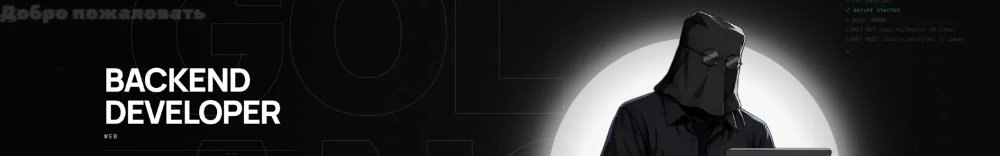

<div align="center">



<br/>

<a href="https://dipass.ru"></a>
<a href="https://t.me/Dipas_di"></a>
<a href="https://discord.com/users/1075427758898950174"></a>
<a href="https://github.com/DipasDi/iFinderMusic"></a>

<br/><br/>


</div>

<br/>

## `01` · ~/about

Backend-разработчик на **Go**. Делаю REST API на Gin, fasthttp и Gorilla, работаю со стандартной библиотекой, горутинами и контекстами, базами данных и контейнеризацией. Интерфейсы проектирую в Figma.

Портфолио, проекты и CV: **[dipass.ru](https://dipass.ru)**

<table width="100%">
<tr>
<td width="50%" valign="top">

**What I Build**
```text
• Backend:      Go, REST APIs, WebSockets, SQL/NoSQL
• Performance:  Profiling, Benchmarking, Optimization
• Systems:      Architecture, Caching, Observability
• UX/UI:        Figma, interfaces for my own products
```

</td>
<td width="50%" valign="top">

**Engineering Approach**
```text
01  Make it understandable and maintainable.
02  Measure and profile before optimizing.
03  Design for failure & keep boundaries clear.
04  Prefer simple, predictable solutions.
```

</td>
</tr>
</table>

<br/>

## `02` · ~/arsenal

<table width="100%">
<tr>
  <td width="160" valign="middle"><b>Languages</b></td>
  <td></td>
</tr>
<tr>
  <td width="160" valign="middle"><b>Backend & Infra</b></td>
  <td></td>
</tr>
<tr>
  <td width="160" valign="middle"><b>Go frameworks</b></td>
  <td>
    
    
    
  </td>
</tr>
<tr>
  <td width="160" valign="middle"><b>Tools</b></td>
  <td></td>
</tr>
</table>

<br/>

## `03` · ~/projects

| | |
|---|---|
| **[UIXDB](https://github.com/DipasDi/UIXDB)** | Веб-клиент для PostgreSQL: SQL-консоль, редактор таблиц, ERD. `HTML` `JS` |
| **[iFinderMusic](https://github.com/DipasDi/iFinderMusic)** | Telegram-бот на Go: поиск и скачивание музыки в MP3. `Go` |

<div align="center">
<a href="https://github.com/DipasDi?tab=repositories">
  
</a>
</div>

<br/>

## `04` · ~/metrics

<div align="center">


<br/><br/>


</div>

<br/>

<div align="center">

```text
Idea → Design → Build → Measure → Find bottlenecks → Improve
```

<a href="https://github.com/DipasDi"></a>
<a href="https://t.me/Dipas_di"></a>
<a href="https://discord.com/users/1075427758898950174"></a>

<br/>


</div>
